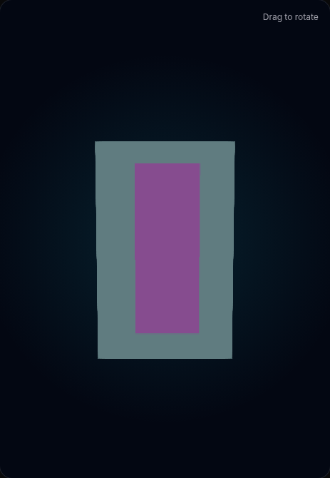

# Nebula Windows build and complete handoff

Current deliverable: **Nebula 2.5.7 / Minecraft 26.2 / Fabric / Windows x86-64 / Java 25**.

**[Download and release notes](https://github.com/WatchSteinsGate/freebubu/releases/tag/handoff-2026-11-16-auth-compatibility)** · **[Full current handoff](docs/HANDOFF.md)** · **[Build instructions](docs/BUILD.md)** · **[Findings and failed approaches](docs/history/FINDINGS.md)**

The supported JAR is `artifacts/Nebula-Windows-direct.jar`:

```text
SHA256  0f34574ebbe06259cabb04e3cf8918d7cedc7bc1a6aa8bc9d10b2523d41d2f93
Size    192425795 bytes
```

JARs use Git LFS. Run `git lfs pull` after cloning; ordinary Git pointers are not runnable JARs. [SHA256SUMS](SHA256SUMS) and [metadata/builds.json](metadata/builds.json) identify the supported Windows artifact, exact original Windows input and experimental Linux reference. The Linux reference is a build/research input, not the supported Windows download.

The current build includes the mirror-based nickname/cape editor, the visible/rotatable animated cape preview, cape state/texture caching, direct statistics patches, real Windows Vulkan JNI bindings, identified native debugging patches and disabled OkHttp pin enforcement. Existing helper members were consolidated into existing classes; the original mixin configuration remains. Original `Loader` and `Key` names are preserved because renaming/merging them broke menu token lookup. Resources retain the reorganized `thatonecatgif/` and `assets/nebula/` layout.

Verified menu regression: with identical proxy/test-account settings, the broken layout JAR made no changelog/leaderboard requests; the corrected JAR sent both with authorization present. **Changelogs returned HTTP 200. Leaderboard returned 403 for the dummy account; real-account success remains unverified.** Vulkan and cape animation passed under Wine/software Vulkan. Native Windows GPU testing, complete authenticated native sessions, arbitrary dynamic attach, native debugger support, and the HTTP Toolkit application itself remain unverified.

## Start here

- [Current architecture, contents, validation, limits and next work](docs/HANDOFF.md)
- [Rebuild with published native input or compile the native DLL](docs/BUILD.md)
- [Exact final JAR layout](docs/jar-layout.md)
- [Editor source, real GIF processing and resolution behavior](editor/README.md)
- [Resolver, debugging and certificate/TLS findings](docs/BOOTSTRAP-AND-DEBUGGING.md)
- [Windows Vulkan repair](docs/GRAPHICS-CRASH.md)
- [Consolidation and preserved native ABI](docs/HELPER-CONSOLIDATION.md)
- [Proxy/interception setup](tests/network/README.md)
- [Current evidence](docs/evidence/current/README.md)
- [Historical experiments, regressions and corrections](docs/history/FINDINGS.md)
- [Cloud/Wine workspace details](docs/ENVIRONMENT.md)

The supplied input was already modified; pristine vendor provenance is not established. The **155,936-record bootstrap table remains required**. No original resolver algorithm was reconstructed, and credentials/authentication were not fabricated to hide the menu regression.


