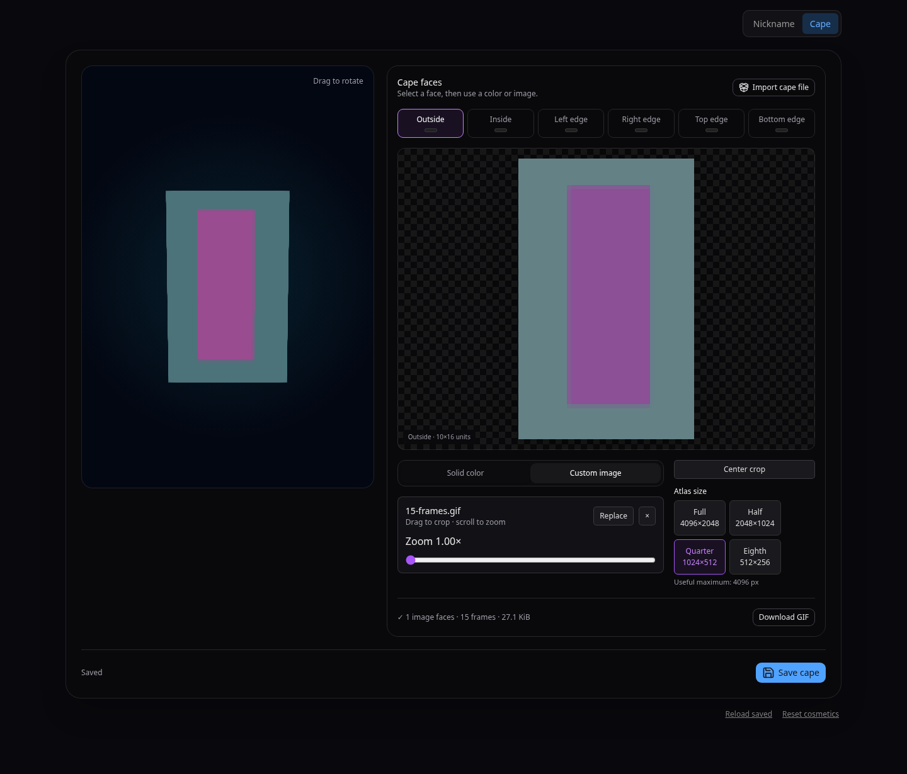

# Nebula direct-patch handoff

Current Windows Fabric mod: **Nebula 2.5.7 / Minecraft 26.2 / Java 25**.
This repository contains the build sources, embedded cosmetics editor, regression
tests, pinned dependency metadata, screenshots, and handoff notes for the supplied
JAR and its direct-patched successor.

**Download the current JAR and the required original input from the
[handoff release](https://github.com/WatchSteinsGate/freebubu/releases/tag/handoff-2026-11-16).**
Checksums and sizes are recorded in [metadata/builds.json](metadata/builds.json)
and [SHA256SUMS](SHA256SUMS). Large JARs are stored with Git LFS under `artifacts/`; the release links to them.
The ordinary Git history stores small LFS pointers. Use `git lfs pull` to fetch
the binaries after cloning, or follow the download links on the release page.

The direct build changes five existing Java classes, the existing editor resource,
and mod metadata; it removes 23 stats/cosmetics add-on entries and adds **zero JAR
entries**. The native DLLs remain byte-for-byte unchanged. Original Nebula mixins
remain, while the inherited stats/cosmetics helper mixins are removed.

- [Full handoff](docs/HANDOFF.md): architecture, changes, paths, validation, and gaps.
- [Bootstrap and debugging analysis](docs/BOOTSTRAP-AND-DEBUGGING.md): what is known,
  what has not been changed, and the work needed for future changes.
- [Environment and runtime](docs/ENVIRONMENT.md): Wine, Java, Fabric, startup, tests.
- [Archive audit](docs/evidence/archive-audit.json) and
  [patch-site audit](docs/evidence/patch-audit.json).



## Build

Requirements: Linux/macOS Bash, Python 3.11+, curl, and **JDK 25**. Windows builds
can use an equivalent environment such as WSL. Runtime testing uses Windows Java
under Wine, independently of the Linux build JDK.

```sh
export JAVA_HOME=/path/to/jdk-25
./build.sh
./test-stats.sh
```

`build.sh` downloads the pinned original artifact and dependency artifacts
unless cached, verifies SHA256 checksums, compiles build-time templates, and merges
them into the existing classes with ASM. Output:

```text
build/artifacts/Nebula-Windows-direct.jar
build/patch-audit.json
```

Optional overrides: `NEBULA_BASE_JAR` points to the exact original input;
`NEBULA_JDK_BIN` points to the JDK's `bin` directory; `NEBULA_CLASSPATH` supplies an
existing dependency classpath. These do not change the original input requirement.
The build reproduces patched contents; ZIP timestamps can change the whole-file
checksum. Compare archive entry contents as well as release checksums.

## Browser tests

Install `tests/requirements.txt`, then run:

```sh
python tests/test_cape.py
python tests/test_cape_highres.py
```

These use installed Chromium at `/usr/bin/chromium`. Adjust the executable path
for another system. Add `--live` to exercise a running editor at port 6969. Live
tests **write and reset cosmetics in the connected instance**; use a dedicated
test profile. They are not intended for a personal production instance.

The site itself returned HTTP 403. The UI was reconstructed from supplied saved
pages, modules, and screenshots; full live-site parity is not claimed. Startup
Java-agent loading was verified. Dynamic attachment, JDWP, native debugging, and
HTTP Toolkit interception are not yet verified. Certificate pinning and native
anti-debug protections have **not** been removed.
